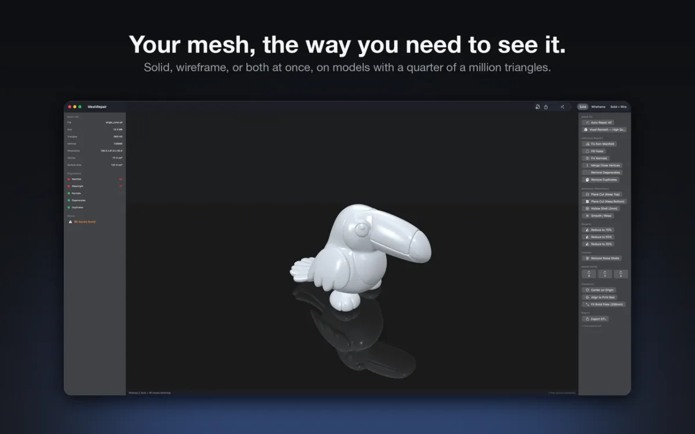
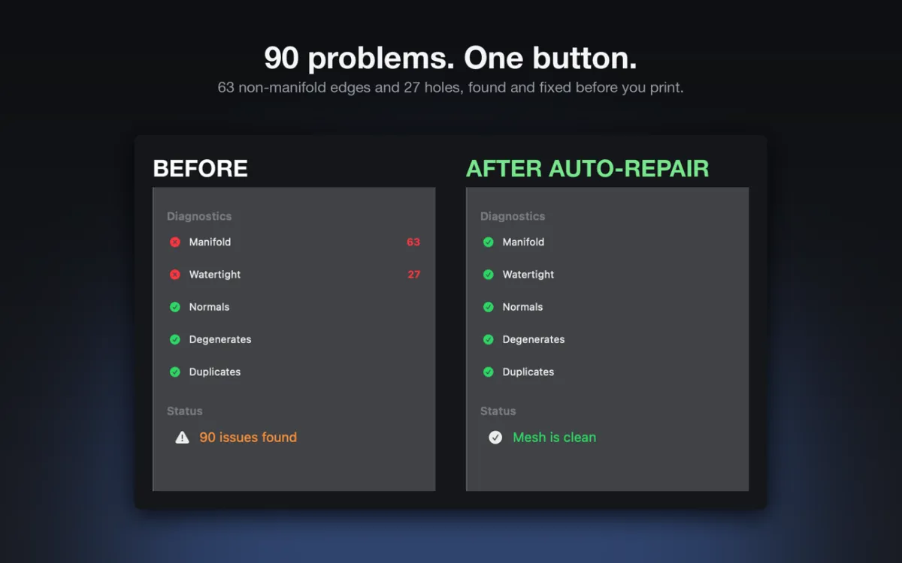

# MeshRepair

Diagnose and repair STL and OBJ files for 3D printing on your Mac.

MeshRepair is a native Mac app that inspects STL and OBJ meshes for geometry errors and repairs them for 3D printing without cloud uploads. It is built for 3D printing hobbyists, makers, and designers who want to fix non-manifold edges, holes, and normals before slicing. Free to download. Optional one-time Pro Unlock, $9.99.

- Website: https://workmanl.github.io/Mesh-Repair/
- Mac App Store: https://apps.apple.com/us/app/meshrepair/id6761517548
- Support: https://github.com/workmanl/Mesh-Repair/issues
- Email: hello@emrldlabs.com
- Privacy: https://workmanl.github.io/Mesh-Repair/privacy.html

## About this repository

The app's source code is not public. This repository is used for support: please open an issue for bug reports and questions.
